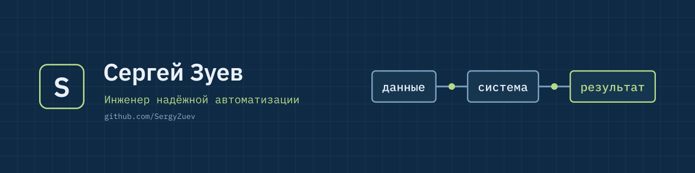

# Сергей Зуев — инженер надёжной автоматизации

DevOps-инженер с опытом собственного бизнеса: строю инфраструктуру под задачи продукта, а не ради технологий.

## Что делаю

- **Инфраструктура для небольших команд** — аудит, миграции и обновления, Docker, мониторинг, CI/CD. С документацией и передачей дел.
- **Автоматизация для бизнеса** — связки таблиц, маркетплейсов и сервисов, Telegram-боты, AI-агенты. С сигналом, если что-то сломалось.

## Опыт

- Перевёл рабочий контур (Jira, Confluence, TeamCity, Bitbucket, RocketChat) с CentOS на Debian 13: Ansible-роли, Docker, мониторинг в Zabbix.
- 7 лет управлял своей студией — понимаю, где у бизнеса теряются время и деньги.
- Инженерное образование по автоматизации (МГСУ).

## Проекты

| Проект | Что делает |
|---|---|
| [Кейсы](https://github.com/SergyZuev/cases) | Миграция сервисов команды и CRM для студии йоги — что было, что сделал, что получилось |
| [comment-agent](https://github.com/SergyZuev/comment-agent) | AI-агент ответов на комментарии с контролем человека |
| [mrt-viewer](https://github.com/SergyZuev/mrt-viewer) | Просмотр МРТ/КТ в браузере, CI/CD с тестами и автодеплоем |
| [tg-vacancy-collector](https://github.com/SergyZuev/tg-vacancy-collector) | Сбор и фильтрация постов из Telegram-каналов |
| [order-radar](https://github.com/SergyZuev/order-radar) | Монитор новых заказов с уведомлениями в Telegram |
| [llm-finetune-case](https://github.com/SergyZuev/llm-finetune-case) | Дообучение LLM (QLoRA) под извлечение данных в JSON |

## Как работаю

- Сначала фиксируем задачу и ТЗ, потом делаю.
- Фиксированный объём, срок и цена.
- Результат проверяю до сдачи, документация — часть результата.

## Связаться

Telegram: [@SergyyZuev](https://t.me/SergyyZuev) · Email: [sergyy.zuev@gmail.com](mailto:sergyy.zuev@gmail.com)
